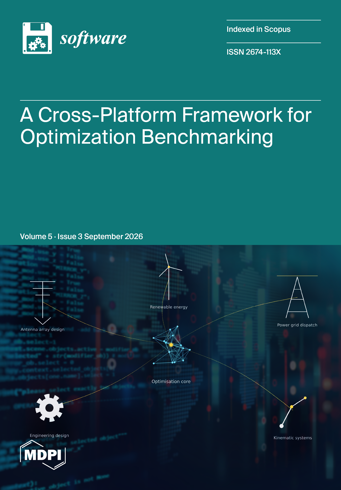
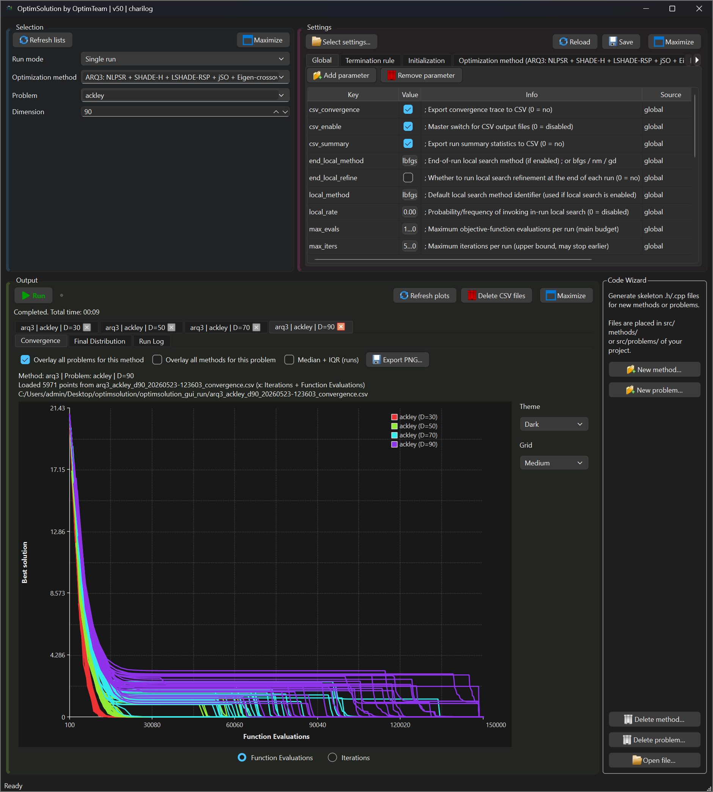
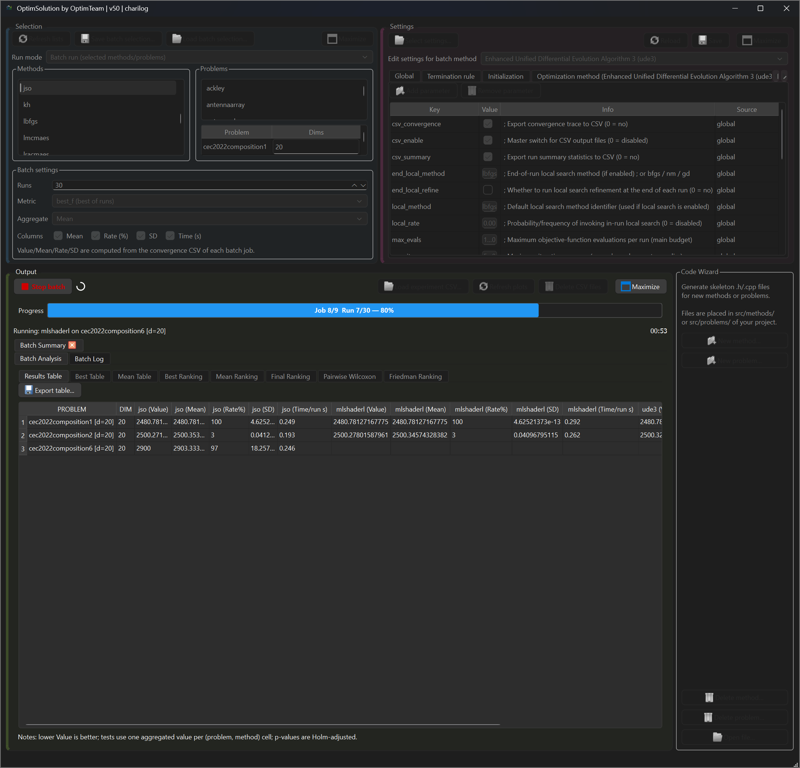
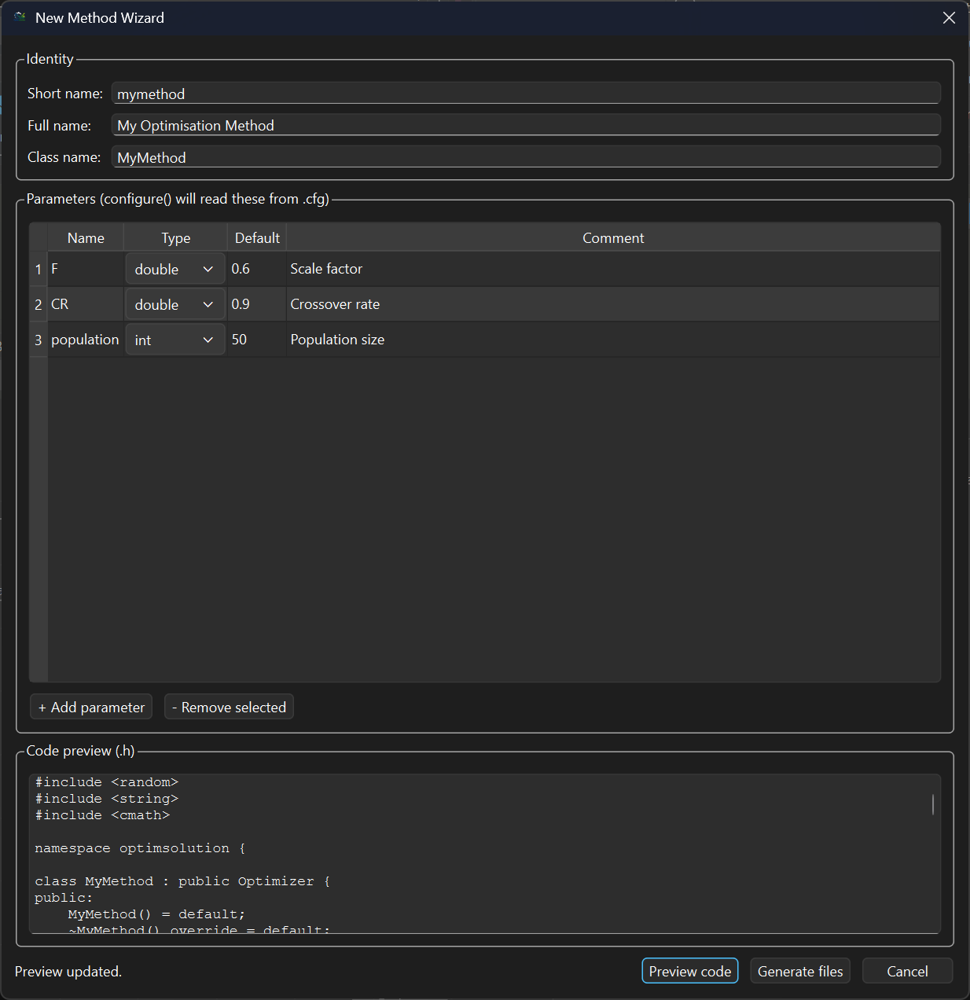
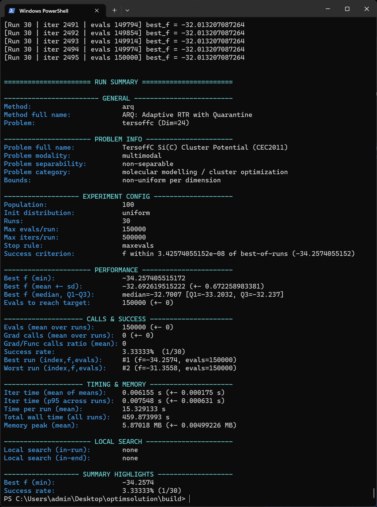

<p align="center">
  
</p>

Optimsolution (version 56+) is a C++ optimization framework that combines a full-featured Qt-based GUI with a CLI for experimenting with population-based metaheuristics and numerical optimizers across benchmark and real-world problems. The GUI drives the complete workflow selecting methods and problems, configuring runs, launching batch experiments, visualizing convergence, and analyzing results through ranking tables and statistical tests while the CLI provides the same capabilities for scripted and headless execution. Both interfaces share the same optimization core and configuration file, and both support explicit computational budgets, multiple initialization strategies, local search integration, and sensitivity analysis of method and problem parameters.

---

## Highlights

- **94 single-objective methods** (87 global optimizers + 7 local solvers) and **3 multi-objective methods**, all behind one common `Optimizer` interface.
- **158 problems**: classical benchmarks, niching/multimodal suites, GKLS classes, **CEC 2017** (29 functions, D = 10/30/50), **CEC 2022**, mechanical-design problems, and many real-world applications (space trajectories, power systems, antennas, process engineering, ...).
- **Eight GUI run modes**: single run, batch, two kinds of sensitivity analysis, multi-objective (Pareto), meta-dataset pipeline (ELA + ML), neural-network loss-landscape analysis, and mid-run algorithm switching (portfolio).
- **Rigorous statistics**: rankings, pairwise Wilcoxon, Friedman, and the **U-score** (trial-based dominance, Price et al. 2023) report exported to Excel.
- **Reproducible and fast**: shared `optimsolution.cfg`, per-run seeds (`seed_base + run_index`), OpenMP-parallel independent runs with results identical to serial execution.
- **Headless-friendly**: every mode has a CLI entry point for servers and clusters.
- **Extensible**: a Code Wizard generates skeletons for new methods/problems and patches `factory.cpp` and `CMakeLists.txt` for you.

---

## Contents

1. [Available methods and problems (CLI)](#1-available-methods-and-problems-cli)
2. [Windows (Console + GUI)](#2-windows-console--gui)
3. [Linux (Console + GUI)](#3-linux-console--gui)
4. [Settings (`optimsolution.cfg`)](#4-settings-optimsolutioncfg)
5. [GUI overview](#5-gui-overview)
6. [Example run console output](#6-example-run-console-output)
7. [CLI reference and run modes](#7-cli-reference-and-run-modes)
8. [Statistics, ranking and reports](#8-statistics-ranking-and-reports)
9. [Python helper scripts (ELA + meta-learning)](#9-python-helper-scripts-ela--meta-learning)

---

## 1) Available methods and problems (CLI)

CLI syntax:

```bash
optimsolution <method> <problem>
```
or

```bash
optimsolution <method> <problem> <dimension>
```

### Methods (94 single-objective + 3 multi-objective)

#### Differential evolution and variants

| Short name | Full name |
|---|---|
| `arq` | ARQ: Adaptive RTR with Quarantine |
| `arq2` | ARQ2: ARQ/IDE roulette with Quarantine + ARQ-only micro-restart + jSO-style K |
| `arq3` | ARQ3: Extended ARQ variant |
| `atde` | ATDE: Age-Turnover Differential Evolution |
| `awjso` | Adaptive-Weight jSO |
| `bjso` | Band-guided jSO |
| `bwjso` | Best-Worst corrected jSO |
| `de` | Differential Evolution |
| `ea4eig` | Evolutionary Algorithms with Eigen crossover |
| `hades` | HADES: Hybrid Adaptive Differential Evolution Strategy |
| `ide` | iDE: improved Differential Evolution (L-SRTDE core) |
| `jde` | Self-adaptive Differential Evolution |
| `jso` | Hybrid Differential Evolution JSO |
| `lsrtde` | L-SRTDE: Linear population size reduction Success-RaTe-based adaptive DE (IEEE CEC 2024 winner) |
| `mjso` | Modified jSO |
| `mlshaderl` | Multi-operator L-SHADE with Reinforcement Learning |
| `nlshadelbc` | NL-SHADE-LBC |
| `pde` | Parallel Differential Evolution |
| `rde` | RDE: Reconstructed Differential Evolution |
| `rdex` | RDEx-SOP: Exploitation-Biased Reconstructed Differential Evolution (IEEE CEC 2025 SOP winner) |
| `sade` | Self-adaptive Differential Evolution (SaDE) |
| `sfcde` | Success-Failure Competitive Differential Evolution |
| `sparq` | SPARQ Optimizer (built on the production `arq3`) |
| `tridentde` | TRIDENT Differential Evolution |
| `ude` | Unified Differential Evolution |
| `ude3` | Enhanced Unified Differential Evolution Algorithm 3 |
| `ujso` | Updated jSO |

#### Particle swarm family

| Short name | Full name |
|---|---|
| `apso` | Adaptive Particle Swarm Optimization |
| `clpso` | Comprehensive Learning PSO |
| `cso` | Competitive Swarm Optimizer (large-scale) |
| `dmspso` | Dynamic Multi-Swarm PSO |
| `glpso` | Genetic Learning PSO |
| `hclpso` | Heterogeneous Comprehensive Learning PSO |
| `imspsodni` | Improved Multiple Subgroups PSO with Dynamic Neighborhood Information |
| `olpso` | Orthogonal Learning PSO |
| `ppso` | Parallel Particle Swarm Optimization |
| `pso` | Particle Swarm Optimization |
| `spso2011` | Standard PSO 2011 |

#### Evolution strategies (CMA-ES family, large-scale ES)

| Short name | Full name |
|---|---|
| `cmaes` | Covariance Matrix Adaptation Evolution Strategy |
| `lmcmaes` | Limited-Memory CMA-ES |
| `lmmaes` | LM-MA-ES: Limited-Memory Matrix Adaptation ES |
| `lracmaes` | Low-Rank Adaptation CMA-ES |
| `mmes` | MMES: Mixture Model-based Evolution Strategy |
| `rmes` | Rm-ES: Rank-m Evolution Strategy |
| `vkdcmaes` | VkD-CMA-ES: projection-based restricted CMA-ES |

#### Bayesian / decomposition-based methods for high dimensions

| Short name | Full name |
|---|---|
| `ccdg2` | Cooperative Co-evolution with DG2 (Differential Grouping v2) |
| `rembo` | Random EMbedding Bayesian Optimization |
| `turbo` | TuRBO: Trust Region Bayesian Optimization (TuRBO-1) |

#### Other population-based, swarm, evolutionary, and hybrid optimizers

| Short name | Full name |
|---|---|
| `abc` | Artificial Bee Colony |
| `aco` | Ant Colony Optimization |
| `acor` | Ant Colony Optimization for Continuous Domains |
| `alo` | Ant Lion Optimizer |
| `ba` | Bat Algorithm |
| `bho` | BioHealing Optimization |
| `cs` | Cuckoo Search |
| `egco` | Eel and Grouper Optimizer |
| `emscso` | Enhanced Modified Sand Cat Swarm Optimization |
| `eo` | Equilibrium Optimizer |
| `fa` | Firefly Algorithm |
| `ga` | Genetic Algorithm |
| `gahs` | Genetic Algorithm with Harmony Search |
| `gao` | Giant Armadillo Optimizer |
| `gsa` | Gravitational Search Algorithm |
| `gwo` | Grey Wolf Optimizer |
| `hba` | Honey Badger Algorithm |
| `hho` | Harris Hawks Optimization |
| `hs` | Harmony Search |
| `jaya` | JAYA |
| `kh` | Krill Herd |
| `mewoa` | Modified Enhanced Whale Optimization Algorithm |
| `mfo` | Moth-Flame Optimization |
| `mpa` | Marine Predators Algorithm |
| `mscso` | Modified Sand Cat Swarm Optimization (multi-strategy fusion) |
| `mvo` | Multi-Verse Optimizer |
| `peao` | PEAO (ported from the OPTIMUS framework) |
| `pga` | Parallel Genetic Algorithm |
| `psao` | Parallel Smell Agent Optimization |
| `psioa` | Parallel Sporulation-Inspired Optimization Algorithm |
| `sa` | Simulated Annealing |
| `sao` | Smell Agent Optimization |
| `sca` | Sine Cosine Algorithm |
| `sioa` | Sporulation-Inspired Optimization Algorithm |
| `sma` | Slime Mould Algorithm |
| `so` | Snake Optimizer |
| `tlbo` | Teaching-Learning-Based Optimization |
| `wca` | Water Cycle Algorithm |
| `woa` | Whale Optimization Algorithm |

#### Local search methods

Usable as stand-alone methods, as the in-run local search (`local_method`), or as the end-of-run refinement (`end_local_method`).

| Short name | Full name |
|---|---|
| `bfgs` | Broyden-Fletcher-Goldfarb-Shanno |
| `cg` | Conjugate Gradient |
| `ncg` | Nonlinear Conjugate Gradient |
| `gd` | Gradient Descent |
| `lbfgs` | Limited-memory Broyden-Fletcher-Goldfarb-Shanno |
| `nm` | Nelder-Mead Simplex |
| `adam` | Adam (optional AMSGrad, learning-rate decay, patience-based stop) |

#### Multi-objective methods (used only in the Multi-objective optimization run mode)
| Short name | Full name |
|---|---|
| `nsga2` | NSGA-II (Non-dominated Sorting Genetic Algorithm II) |
| `moead` | MOEA/D-DE (decomposition-based, Tchebycheff scalarization) |
| `mopso` | Multi-Objective Particle Swarm Optimization |

### Problems (158)

#### Classical and synthetic benchmarks

`ackley`, `alpine1`, `attractivesector`, `beale`, `bohachevsky1`, `bohachevsky2`, `bohachevsky3`,
`booth`, `branin`, `bucherastrigin`, `bukinn6`, `camel`, `cigar`, `colville`, `cosinemixture`,
`crossintray`, `differentpowers`, `diracproblem`, `dixonprice`, `dropwave`, `easom`, `eggholder`,
`ellipsoidal`, `equalmaxima`, `expotential`, `gallagher101`, `gallagher21`, `goldstein`, `griewank`,
`griewankrosenbrock`, `hansen`, `hartmann3`, `hartmann6`, `holdertable`, `katsuura`, `langermann`,
`levy`, `lunacekbirastrigin`, `matyas`, `mccormick`, `michalewicz`, `perm`, `potential`, `powell`,
`rastrigin`, `rastrigin2`, `rosenbrock`, `rotatedrosenbrock`, `salomon`, `schaffer`, `schwefel`,
`shekel5`, `shekel7`, `shekel10`, `shubert`, `sinusoidal`, `sphere`, `stepellipsoidal`, `test2n`,
`test30n`, `trid`, `weierstrass`, `whitley`, `zakharov`

#### Niching / multimodal specialized benchmarks

`vincent`, `fiveunevenpeaktrap`
*(see also `equalmaxima`, `gallagher101`, `gallagher21`, `shubert` above — all originate from the same CEC-style niching/multimodal literature)*

#### Real-world and application-driven problems

`antennaarray`, `antennaula`, `bifunctionalcatalyst`, `cassini`, `cassini1`, `datacentercooling`,
`ded1`, `ded2`, `eld1`, `eld2`, `eld3`, `eld4`, `eld5`, `fmsynth`, `gascycle`, `gtoc1`,
`heatexchanger`, `himmelblau`, `hydrothermal`, `ik6dof`, `interceptorguidance`, `messenger`,
`ofdmpower`, `polyphase`, `portfoliomv`, `rosetta`, `sagas`, `smartportenergy`,
`stirredtankreactor`, `tandem`, `tersoffb`, `tersoffc`, `tnep`, `transmissionpricing`,
`vibratingplatform`, `weatherirrigation`, `wirelesscoverage`

#### Mechanical engineering design benchmarks

`weldedbeam`, `speedreducer`, `pressurevessel`, `springdesign`, `cantileverbeam`, `threebartruss`,
`geartrain`

#### GKLS test classes

`gkls250`, `gkls350`, `gkls2100`

#### CEC 2022 representative functions

`cec2022_zakharov`, `cec2022_rosenbrock`, `cec2022_schafferf7`,
`cec2022_noncontinuous_rastrigin`, `cec2022_levy`, `cec2022_hybrid2`, `cec2022_hybrid6`,
`cec2022_hybrid10`, `cec2022_composition1`, `cec2022_composition2`, `cec2022_composition6`,
`cec2022_composition7`

#### CEC 2017 functions (29 of 29 usable functions -- F2 was officially deleted by the benchmark's own authors)

`cec2017f1`, `cec2017f3`, `cec2017f4`, `cec2017f5`, `cec2017f6`, `cec2017f7`, `cec2017f8`,
`cec2017f9`, `cec2017f10`, `cec2017f11`, `cec2017f12`, `cec2017f13`, `cec2017f14`, `cec2017f15`,
`cec2017f16`, `cec2017f17`, `cec2017f18`, `cec2017f19`, `cec2017f20`, `cec2017f21`, `cec2017f22`,
`cec2017f23`, `cec2017f24`, `cec2017f25`, `cec2017f26`, `cec2017f27`, `cec2017f28`, `cec2017f29`,
`cec2017f30`

All shift vectors, rotation matrices, and shuffle permutations are the exact official data,
verified against a recompiled copy of the official reference implementation. Every function
supports **D = 10, 30, 50** (see the source comments in `src/problems/cec2017_f6.h`,
`cec2017_f8.h`, `cec2017_f14.h`, and `cec2017_f20.h` for the reference-code quirks that are
deliberately reproduced rather than "fixed").

#### Multi-objective benchmarks (used only in the Multi-objective optimization run mode)

`zdt1`, `zdt2`, `zdt3`, `zdt4`
*(see also `portfoliomv` above, under Real-world and application-driven problems -- it is
multi-objective too)*

#### Machine-learning problem (used by the neural-network landscape mode)

A feed-forward neural network is exposed as an ordinary `Problem` (`src/problems/nn_problem.*`), so every optimizer above can train it. The `datasets/` folder ships ready-to-use `.train` / `.test` pairs (e.g. `iris`, `wine`, `heart`, `breast`, `pima`, `spambase`, `satimage`, `eeg*`, ...).

---

## 2) Windows (Console + GUI)

> **Windows installer available:** Download and run **Optimsolution.exe** from:
>
> **[Optimsolution.exe (Windows Installer)](https://www.dit.uoi.gr/files/optimsolution.zip)**

### Prerequisites
- Visual Studio 2022 (Community or Build Tools)
  - Workload: **Desktop development with C++**
  - Components: **MSVC v143**, **Windows 10/11 SDK**
- CMake available in **PATH**
- **Qt 6.x (MSVC 2022 x64)** for the GUI target, e.g. `C:\Qt\6.10.1\msvc2022_64`

Recommended shell: **x64 Native Tools Command Prompt for VS 2022** or **Developer PowerShell for VS 2022**.

### Build and run (GUI + CLI) — Release

Delete any existing build directory.

```powershell
Remove-Item -Recurse -Force .\build -ErrorAction SilentlyContinue
```

Configure with the GUI target enabled.

```powershell
cmake -S . -B build -G "Visual Studio 17 2022" -A x64 `
  "-DCMAKE_PROJECT_INCLUDE:FILEPATH=$PWD/cmake/optimsolution_gui.cmake" `
  "-DCMAKE_PREFIX_PATH=C:\Qt\6.10.1\msvc2022_64"
```

Build both targets.

```powershell
cmake --build build --config Release --target optimsolution_gui
cmake --build build --config Release --target optimsolution
```

Deploy Qt runtime next to the GUI executable.

```powershell
& "C:\Qt\6.10.1\msvc2022_64\bin\windeployqt.exe" `
  --no-translations --compiler-runtime `
  ".\build\Release\optimsolution_gui.exe"
```

Run.

```powershell
.\build\Release\optimsolution_gui.exe
.\build\Release\optimsolution.exe arq tersoffc
```

---

## 3) Linux (Console + GUI)

### Prerequisites
- GCC or Clang, CMake, Ninja (recommended)
- Qt 6.x development packages

### Build and run — Release

```bash
sudo apt update && sudo apt upgrade
sudo apt install qt6-base-dev qt6-base-dev-tools qt6-tools-dev qt6-tools-dev-tools
rm -rf build
cmake -S . -B build -G Ninja \
  -DCMAKE_BUILD_TYPE=Release \
  -DCMAKE_PROJECT_INCLUDE=cmake/optimsolution_gui.cmake
cmake --build build --target optimsolution_gui
cmake --build build --target optimsolution
./build/optimsolution_gui
./build/optimsolution arq tersoffc
```

OpenMP is detected automatically by CMake; if it is not found, the build falls back to serial execution and `parallel_runs` has no effect.

---

## 4) Settings (`optimsolution.cfg`)

Both the CLI and GUI read experiment defaults from `optimsolution.cfg`. The GUI can apply additional runtime-only overrides (e.g. forcing CSV convergence output for plots) without modifying the file. The CLI looks for `optimsolution.cfg` in the current directory and walks up through parent directories (also starting from the executable's folder).

### Key sections

```ini
[global]
population       = 200
max_iters        = 500000
max_evals        = 150000      ; also accepts a per-dimension form such as 10000xD
seed_base        = 4242
runs             = 30
success_tol      = 1e-8
local_rate       = 0.00
local_method     = lbfgs
end_local_refine = 0
end_local_method = lbfgs   ; bfgs / nm / gd / cg / ncg / adam
summary_enable   = 1
parallel_runs    = 0       ; 0 = serial, 1 = OpenMP-parallel independent runs (same results, either way)
omp_threads      = 0       ; 0 = auto (all cores), N = cap at N threads

[stop]
rule = maxevals            ; bss|wss|tss|boss|srs|irs|doublebox|maxevals|all|none
eps  = 1e-10

[init]
type = uniform             ; uniform|normal|cauchy|laplace|lognormal|exponential|beta|levy|lhs|halton|oppositional
```

A method section overrides any global key for that optimizer only.

```ini
[arq]
population   = 100
pbest_frac   = 0.12
F            = 0.1
CR           = 0.9
archive_rate = 1.5
batch_frac   = 0.5
local_rate   = 0.00
local_method = lbfgs
```

### Other configuration areas

| Section / keys | Purpose |
|---|---|
| `[global]` `csv_enable`, `csv_convergence`, `csv_summary` | Control CSV output (convergence trace and per-run summary). |
| `[global]` `summary_show_*` | Choose which blocks of the console summary are printed (general, problem, config, performance, calls & success, timing & memory, local search, highlights). |
| `[global]` `uscore_report` | Export `uscore_report_<timestamp>.xlsx` after a batch run. |
| `[stop]` `sim`, `sumRate` | Extra parameters for the similarity/summation-based stop rules. |
| `[init]` `mu`, `sigma`, `gamma`, `b`, `lambda`, `alpha`, `beta`, `c` | Distribution parameters for the initialization strategies. |
| `[sensitivity]` | Grid sweeps over method parameters (see below). |
| `[nnlandscape]` `parallel_jobs`, `bootstrap_jobs` | Concurrency of the neural-network landscape mode and of the bootstrap-CI stage. |
| `[pipeline]` `extract_ela_jobs` | Concurrency of ELA feature extraction in the meta-dataset pipeline. |
| `[<method>]` | Per-method parameters (population, `F`, `CR`, archive sizes, learning rates, ...). |

### Sensitivity analysis example

```ini
[sensitivity]
enabled = 1
mode    = grid                  ; currently only "grid" is used
output  = sensitivity_results.csv

params  = F, CR                 ; must match keys read by the method
values.F  = 0.3, 0.5, 0.8
values.CR = 0.4, 0.7, 0.9
```

Every combination is run `runs` times and summarized to a CSV. See [`docs/sensitivity_example.cfg`](./docs/sensitivity_example.cfg).

---

## 5) GUI overview

The GUI and CLI share the same optimization core. The GUI adds eight run modes, convergence plotting, batch analysis, sensitivity studies, and a code wizard for extending the framework without leaving the application.





### Run modes

| Mode | Description |
|---|---|
| **Single run** | One run of the selected method on the selected problem. Produces a convergence plot and run summary. |
| **Batch run** | All selected methods × all selected problems for N runs. Results appear in eight analysis views: Results Table, Best Table, Mean Table, Best Ranking, Mean Ranking, Final Ranking, Pairwise Wilcoxon, Friedman Ranking. |
| **Sensitivity analysis of method parameters** | Sweeps method parameters over a defined range (problem fixed). Shows how each parameter value affects the result. |
| **Sensitivity analysis of problem parameters** | Sweeps problem parameters such as dimension or bounds (method fixed). Characterizes problem difficulty as a function of its own configuration. |
| **Multi-objective optimization** | Runs a Pareto-based method (`nsga2`, `moead`, `mopso`) against a multi-objective problem (`zdt1`-`zdt4`, `portfoliomv`) and plots the resulting Pareto front. Population and generations are read from `optimsolution.cfg`, not set in this panel. |
| **Meta-dataset pipeline (batch + ELA + ML)** | A guided multi-stage workflow: batch ranking → landscape sampling → ELA feature extraction → training of an algorithm-selection meta-learner (see [§9](#9-python-helper-scripts-ela--meta-learning)). |
| **Neural-network landscape / generalization gap** | Trains networks on the bundled datasets with any optimizer, samples the loss landscape around the found minimum, and relates sharpness to the generalization gap (train / sample / bootstrap CI stages). |
| **Portfolio / dynamic algorithm switching** | Splits the evaluation budget into segments and switches between candidate methods mid-run, warm-starting each segment near the incumbent (see [§7](#7-cli-reference-and-run-modes)). |

The single-objective modes (single, batch and both sensitivity modes) can run their independent repetitions in parallel via OpenMP (see [§4](#4-settings-optimsolutioncfg)), with results that are numerically identical to a fully serial run.

### Why the GUI is significantly faster than running the CLI directly

Although both the GUI and CLI share the same optimization core, the GUI delivers substantially higher throughput for multi-run and batch experiments. The performance gap comes from several architectural decisions in the GUI:

**Zero inter-run overhead.** The GUI manages a job queue (`batchQueue_`) and launches each CLI process immediately after the previous one completes — with no manual setup, no re-reading of configuration files between jobs, and no human latency between runs. In a batch of *M* methods × *P* problems × *N* runs, all *M × P* jobs are dispatched sequentially and automatically without any user interaction.

**Runtime configuration snapshots.** Instead of writing and re-reading `optimsolution.cfg` on disk for every run, the GUI builds an in-memory configuration snapshot (`optimsolution_gui_merged.cfg`) and passes it to the CLI via `--config`. GUI edits (population size, budget, method parameters) act as runtime overrides and are applied instantly without touching the on-disk file. This eliminates repeated file-system I/O for configuration between jobs.

**Off-thread CSV post-processing.** After each run completes, CSV parsing, table population, and statistical aggregation (rankings, Wilcoxon, Friedman) are performed off the GUI thread via `QtConcurrent::run`. The GUI thread never blocks waiting for post-processing: it immediately starts the next job in the queue while the analysis runs in the background.

**Dedicated log-writer thread.** Batch run logging uses a dedicated `batchLogWriter_` thread so that writing progress to the UI log panel does not compete with the optimizer process for CPU or I/O time.

**High-frequency live monitoring.** UI progress updates are driven by timers: 250 ms for batch log flushing, 200 ms for single-run log flushing, and 150 ms for sensitivity CSV polling. This tight polling interval means convergence data and progress bars are updated in near real-time without any manual file inspection by the user.

**Automatic configuration consistency.** The GUI guarantees that every job in a batch uses exactly the same configuration snapshot. When running the CLI manually, configuration drift between runs (accidental edits to `.cfg`, different working directories, forgotten flags) is a common source of irreproducible results. The GUI eliminates this class of error entirely.

The practical effect is that a batch experiment that would take several hours of manual CLI orchestration — launching processes, checking outputs, updating configuration, re-running failed jobs — can be completed in the same wall-clock time as the computations themselves, with no idle time between jobs. With OpenMP parallel runs enabled on top of this, the computations themselves can now also make use of all available CPU cores.

### Code Wizard
The Code Wizard panel (bottom-right) generates skeleton `.h` and `.cpp` files for new methods or problems, patches `factory.cpp` and `CMakeLists.txt` automatically, and triggers a rebuild on the next startup.

---

## 6) Example run console output

The following screenshot shows the last iterations of **Run 30** and the final summary for:

- **Method:** `arq` · **Problem:** `tersoffc (Dim=24)` · **Runs:** 30 · **Budget:** 150 000 evals/run
- CLI syntax:
```bash
optimsolution arq tersoffc
```



---

## 7) CLI reference and run modes

```text
optimsolution <method> <problem> [dimension]
optimsolution --multi <method> <problem> [dimension]
optimsolution --batch <batch_list_file> [output_dir]
optimsolution --features <problem> [dimension] [n_samples] [output_file]
optimsolution --rank <batch_master.csv> [output_prefix] [metric_column]
optimsolution --nnlandscape --dataset <path.train> --out-prefix <prefix> --out-summary <summary.csv> [options]
optimsolution --portfolio --problem <name> [--dim D] --methods m1,m2,m3 --out-prefix <prefix> [options]
optimsolution --complexity --methods m1,m2,m3 [--dims 10,30,50] [--problem cec2017f18] [--evals 200000] [--runs 5] [--out complexity.csv]
```

Run any mode with `-h` / `--help` for its full option list.

### Single run
`optimsolution <method> <problem> [dimension]` — runs `runs` independent repetitions with the settings in `optimsolution.cfg` and prints a sectioned summary (general, problem info, experiment config, performance, calls & success, timing & memory, local search, highlights). Optional CSV outputs: convergence trace and one summary row per run.

### Multi-objective (`--multi`)
Runs `nsga2`, `moead` or `mopso` on `zdt1`–`zdt4` or `portfoliomv` and writes the Pareto front.

### Batch (`--batch`)
Runs a whole experiment grid headlessly — ideal for servers and clusters. The batch list file is plain text (blank lines and `#` comments are ignored):

```text
methods:  pso,de,arq,jso,gwo
problems: ackley,rastrigin,sphere
dims:     2,5,10,20,30
# or explicit (problem:dim) pairs
pairs:    rastrigin:30, sphere:10, hartmann6:0
# or a fully sparse list of (method:problem:dim) triples
triples:  jso:sphere:10, cmaes:sphere:10, jso:ackley:30
```

Each combination writes a `*_summary.csv`; all are merged into `batch_master.csv`. (`dim = 0` means the problem's fixed/default dimension.)

### Ranking (`--rank`)
Turns `batch_master.csv` into ranked tables (`batch_ranked.csv`) on a chosen metric column.

### Landscape features (`--features`)
Samples a problem's landscape (one `(problem, dim)` instance at a time) into a pflacco-ready CSV, the input of the ELA extraction step.

### Algorithm complexity (`--complexity`)
Measures **T0, T1, T2 and C = (T̂2 − T1) / T0** following the CEC 2017 bound-constrained competition procedure (default test problem `cec2017f18`), runs serially, medians over repetitions, and writes `complexity.csv`.

### Portfolio / dynamic algorithm switching (`--portfolio`)
Splits the total evaluation budget into segments and decides before each segment which method of a candidate list runs next, using the incumbent best point as warm start (the problem bounds are temporarily shrunk around it). Policies:

| Policy | Behavior |
|---|---|
| `fixed` | Always the same method — baseline under identical bookkeeping. |
| `round_robin` | Cycles through `--methods` regardless of performance. |
| `greedy_probe` | Short, identically warm-started probes of every candidate; the best probe gets the full segment. Probe cost counts against the shared budget. |

Useful options: `--segment-evals`, `--total-evals`, `--probe-evals`, `--runs`, `--seed-base`, `--with-baselines`, `--landscape-log`, `--warmstart-radius-min`, `--warmstart-decay`.

### Neural-network landscape (`--nnlandscape`)
Trains a feed-forward network with any registered optimizer (gradient-based or population-based), then samples the training-loss landscape locally around the found minimum at several radii. Writes pflacco-ready landscape CSVs and a summary row with the **generalization gap** (validation − training loss) and perturbation-sharpness statistics. Options include `--hidden`, `--activation`, `--optimizer`, `--iterations`, `--population`, `--wbound`, `--seed`, `--radii`, `--local-samples`, `--label`.

---

## 8) Statistics, ranking and reports

- **Per-run outputs:** best / mean / standard deviation, success rate (`success_tol`), function calls, timing and memory, and local-search usage.
- **Termination rules:** `maxevals`, plus population-based criteria `bss`, `wss`, `tss`, `boss`, `srs`, `irs`, `doublebox` (or `all` / `none`).
- **Initialization strategies:** uniform, normal, Cauchy, Laplace, log-normal, exponential, beta, Lévy, Latin hypercube, Halton and oppositional.
- **Batch analysis views:** Results/Best/Mean tables, Best/Mean/Final rankings, pairwise Wilcoxon tests and the Friedman ranking.
- **U-score report:** trial-based dominance ranking following Price, Kumar & Suganthan (*Swarm and Evolutionary Computation*, 78, 101287, 2023) — the IEEE CEC 2025 "accuracy and speed" scheme. Trials are pooled per problem, ranked by reaching the target first, then by evaluations (speed) or final error, ties get averaged ranks, and per-algorithm U-scores are summed across problems. Enabled with `uscore_report = 1`; exported as `uscore_report_<timestamp>.xlsx`.
- **Local search integration:** in-run (`local_rate`, `local_method`) and end-of-run refinement (`end_local_refine`, `end_local_method`).

---

## 9) Python helper scripts (ELA + meta-learning)

The `py_scripts/` folder (keep it next to `CMakeLists.txt`) powers the GUI's *Meta-dataset pipeline* and *Neural-network landscape* modes; the scripts can also be run by hand.

| Script | Purpose |
|---|---|
| `extract_ela_features.py` | Computes Exploratory Landscape Analysis features (via `pflacco`) from `--features` samples. |
| `train_meta_learner.py` | Trains a landscape-aware algorithm-selection model (leave-one-problem-out evaluation). |
| `train_gap_regressor.py`, `train_gap_regressor_logtransform.py` | Predict the neural-network generalization gap from landscape features. |
| `bootstrap_lodo_ci.py` | Bootstrap confidence intervals with leave-one-dataset-out (parallelizable via `bootstrap_jobs`). |
| `run_pilot_batch_mode7.py` | Pilot batch driver for the neural-network landscape mode. |

Dependencies: `pip install pflacco --no-deps`, then `numpy pandas scikit-learn scipy numdifftools SALib` and `pyDOE==0.3.8`. See [`py_scripts/README_python_ela.md`](./py_scripts/README_python_ela.md) for the exact installation notes.

